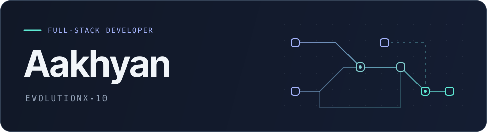

  

  CS grad building full-stack apps with <b>TypeScript, React, and Next.js</b>. 
  I care about apps that work offline, accessible interfaces, and fast, predictable data access.

  <a href="https://github.com/EvolutionX-10">GitHub</a> &nbsp;·&nbsp;
  <a href="https://leetcode.com/u/EvolutionX/">LeetCode</a> &nbsp;·&nbsp;
  <a href="https://wakatime.com/@f625cbe5-27ad-49a9-802e-e3c358c1b998">WakaTime</a>

## What I care about

- **Offline by design.** PWAs, service workers, and IndexedDB mutation queues that keep things moving when the connection drops.
- **Fast from UI to database.** First Contentful Paint budgets, fewer N+1 queries, connection pooling, and deliberate caching.
- **Interfaces that feel right.** Accessible components, consistent design systems, and thoughtful interactions.
- **Strong fundamentals.** [650+ LeetCode problems solved](https://leetcode.com/u/EvolutionX/) and a continuing interest in competitive programming.

## Tools I reach for

  
  
  
  
  
  
  
  

For UI, I work with **shadcn/ui, Radix, and Motion**. For data and deployment, **Supabase and Railway**.

## Beyond the code

I enjoy competitive programming and usually have music on while I build.

  
<b>Coding activity</b> · GitHub, LeetCode, and time at the keyboard

   

  

    
  

  

    
  

  

    
  

  
<b>A little contribution snake</b>

   

  <picture>
    <source media="(prefers-color-scheme: dark)" srcset="https://raw.githubusercontent.com/EvolutionX-10/EvolutionX-10/output/github-snake-dark.svg" />
    <source media="(prefers-color-scheme: light)" srcset="https://raw.githubusercontent.com/EvolutionX-10/EvolutionX-10/output/github-snake.svg" />
    
  </picture>

